# ScopePay architecture

```mermaid
flowchart LR
    Studio[Studio workspace] --> API[FastAPI server]
    API --> DB[(SQLite)]
    API --> Analysis[Model adapter / explicit demo rules]
    Analysis --> Citations[Schema and exact-source validation]
    Citations --> Quote[Human-edited quote]
    Quote --> Version[Locked version + SHA-256]
    Version --> Client[Private client review]
    Client --> Accept[Explicit acceptance]
    Accept --> PayPal[PayPal Sandbox order / approval]
    PayPal --> Capture[Server-side capture verification]
    PayPal --> Hook[Signed, deduplicated webhook]
    Hook --> Capture
    Capture --> DB
    DB --> Export[Markdown / JSON / checksums ZIP]
```

## State transitions

`draft → awaiting → accepted → paid` for verified Sandbox captures.

`draft → awaiting → accepted → demo_paid` for explicit simulated walkthrough payments.

`draft → awaiting → accepted_no_payment` for a selected no-charge change. No capture or paid timestamp is created.

`awaiting → declined → superseded` or `awaiting → superseded`, plus a new independent `draft` with incremented version. Accepted/paid versions cannot be revised. Old client links cannot accept a superseded quote.

## Invariants

- AI and input documents cannot set payment instructions. The model proposes categories and citations; the studio reviews prices and clarifications.
- All amounts are integer USD cents. Negative, fractional-cent, unknown-item, duplicate-item, empty-selection and excessive quotes are rejected. A zero-total selected quote is valid but never starts checkout.
- Selected ambiguous items require a recorded clarification before publication. Classification corrections retain the original analysis category and require a recorded reason. Included work cannot carry a fee.
- Publication takes an immutable snapshot of baseline, selected items, quote amount, due date, note and payment mode. Its canonical representation produces a SHA-256 hash. The acceptance stores that same hash/version.
- Subsequent analysis includes previously accepted additions. It can still require human correction when terms overlap or prior scope is ambiguous.
- Publication and acceptance recheck the agreed scope under a project-level lock. Acceptance of another version invalidates older unaccepted snapshots. A stale revision reanalyzes against the latest baseline before superseding the old quote. Accepted-but-unpaid changes already count as agreed scope; payment remains a separate state.
- The browser never decides the payable amount. PayPal order creation reads the locked quote from SQLite.
- A Sandbox payment requires a matching order ID, purchase-unit reference, quote hash, completed capture, amount and currency. Approval is not payment. Demo payments use a different state and clearly labeled receipt.
- PayPal create/capture calls use stable request IDs per checkout attempt. Retries first read the order to recover completed captures or finish approved orders. Only voided or unavailable orders get a replacement attempt; network errors do not replace them. Status refresh never captures. Webhook event IDs are deduplicated after verification and processing.
- Exports exclude session cookies, share tokens, approval URLs, API keys and client secrets.
- Human-readable exports distinguish proposed from confirmed scope and include the client response, version fingerprint, payment environment, capture metadata and activity. No-charge confirmations are not payment receipts.
- New revisions freeze minimal previous terms and feedback, excluding access/payment tokens. Their fingerprints include this source snapshot. Deterministic comparisons match stable item IDs, or unique exact request evidence plus rate category after reanalysis; ambiguous matches are explicit additions/removals. Historical quotes without a revision snapshot keep their existing hash behavior.
- The owner-only project ledger aggregates only confirmed statuses. Agreed value is recorded original fee plus confirmed additions, not revenue. Pending proposals and stale proposals are not agreed value. Sandbox captures and simulated payments remain separate, with no original-fee payment tracking or invented zero-fee receipts.

## Prototype boundaries

One studio, one currency, flat-rate additions, typed client confirmation, and synthetic demo data. No tax calculation, certified electronic signatures, escrow, payment release milestones, production payments, OAuth onboarding for multiple merchants, automatic email delivery, or legal/dispute guarantees. Additional items outside the rule examples require a configured model or manual classification/clarification.

Public deployment requires explicit owner access protection, HTTPS, a persistent data volume, configured return URLs and optional webhooks. Production multi-tenancy, session management, backups, retention and operational monitoring need further work before handling real customer data.

The current locks are process-local. Run one Uvicorn worker for this SQLite prototype; multi-worker/distributed operation needs database-level transition coordination.
